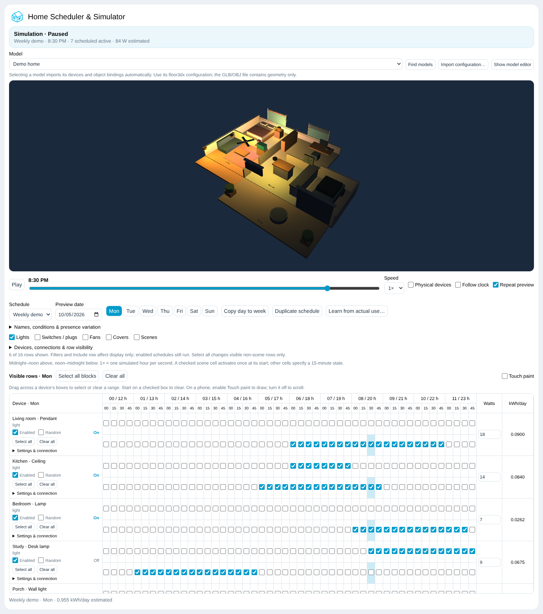
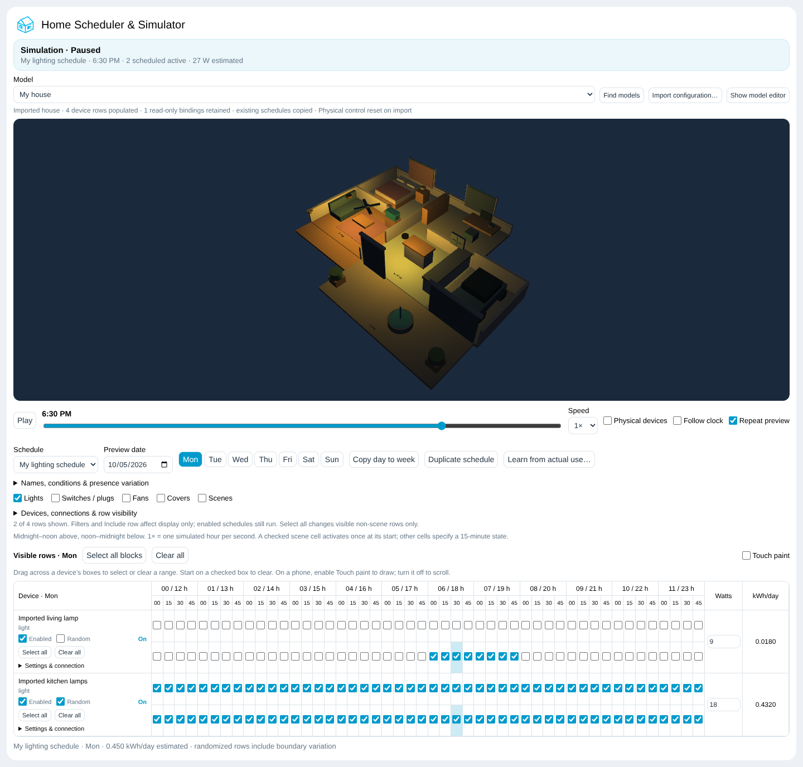
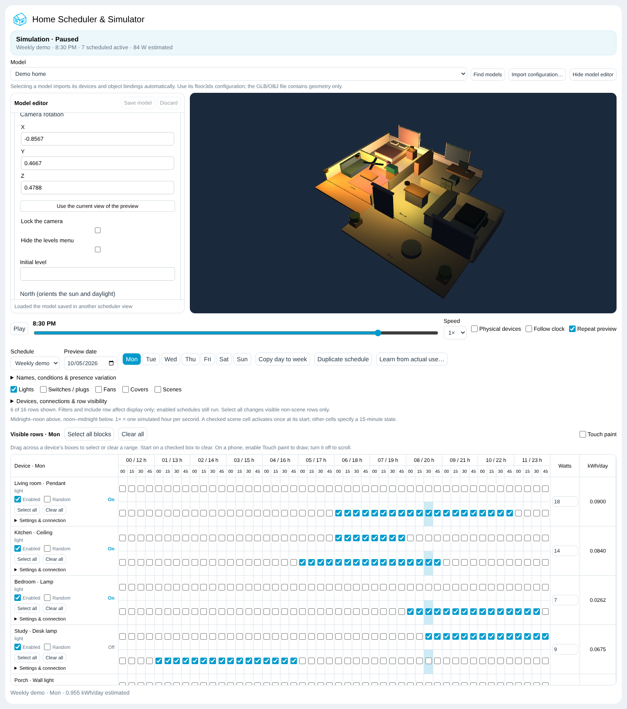
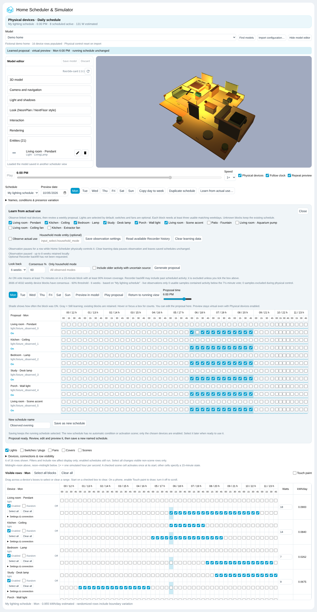

# Home Scheduler & Simulator

Plan lights, switches and plugs, fans, blinds, curtains, other covers, and scene activations in a weekly quarter-hour grid. Play a day in an original fictional 3D home, select your own configured house model, or watch the simulated device indicators without 3D. Connect real devices when you want the same schedules to operate your home.

Version **0.4.1** · Home Assistant custom integration · MIT license

New in 0.4.1: works with **floor3dx-card 2.x** (three.js r186); see [floor3dx-card 2.x](#floor3dx-card-2x). 0.4.0 added **Learn from actual use**, which observes linked lights, switches/plugs and fans, proposes a weekly routine from matching weekdays, and lets you review and play it in the model before saving a new schedule.



The scheduler card, demo model, and cyan house branding are included. The 3D renderer and its visual editor come from **[FortranFour/floor3dx-card](https://github.com/FortranFour/floor3dx-card)**, installed separately. Thermostats are not scheduled.

The model adapter is designed for the floor3d family of cards and has been tested with **floor3dx-card 1.4.0 and 2.3.0**. The adapter accepts `custom:floor3dx-card` and `custom:floor3d-card` configurations; renderer-specific features and visual editors in other variants may differ.

- [Install through HACS](#install-through-hacs)
- [Manual installation](#manual-installation)
- [Upgrade an existing manual installation](#upgrade-an-existing-manual-installation)
- [Add the dashboard card](#add-the-dashboard-card)
- [Preview and physical operation](#preview-and-physical-operation)
- [Edit the grid](#edit-the-grid)
- [Device settings and energy](#device-settings-and-energy)
- [Select or import your own model](#select-or-import-your-own-model)
- [Use the visual model editor](#use-the-visual-model-editor)
- [Schedules, conditions, and presence variation](#schedules-conditions-and-presence-variation)
- [Scenes](#scenes)
- [Learn from actual use](#learn-from-actual-use)
- [Storage, updates, and removal](#storage-updates-and-removal)
- [Troubleshooting](#troubleshooting)
- [Development and publishing](#development-and-publishing)

## Requirements

| Requirement | Purpose |
| --- | --- |
| Home Assistant **2026.3.0 or later** | Integration, scheduling, and local integration branding |
| An administrator account | Installation and scheduler commands |
| HACS, or access to `/config/custom_components` | Installation |
| floor3dx-card **1.4.0 or later** (2.3.0 tested) | Optional 3D view and native visual editor |
| A browser with WebGL | Optional 3D rendering |

Home Assistant is required even for simulation. The demo has no real device targets. A card with `show_model: false` uses the schedule grid and changing state indicators without loading floor3dx.

## Install through HACS

This repository can be installed as a **custom repository**. It is not automatically included in HACS's default catalog.

1. Open **HACS → menu → Custom repositories**.
2. Add `https://github.com/FortranFour/home-scheduler` with category **Integration**.
3. Find **Home Scheduler & Simulator** and download it.
4. **Restart Home Assistant**, then open **Settings → Devices & services → Add integration**.
5. Search for **Home Scheduler & Simulator** and confirm setup. An existing YAML installation imports its setup automatically; do not create a second instance.
6. For 3D, add `https://github.com/FortranFour/floor3dx-card` to HACS with category **Dashboard**, install version 1.4.0 or later, and follow that project's resource instructions. Keep an existing floor3dx resource rather than adding a duplicate.
7. Add the scheduler card as described below and reload the browser.

**No additional scheduler JavaScript/module resource is required.** The integration registers its own card and serves its files at `/home_scheduler/`. The floor3dx companion still needs its own installation/resource.

The icon and light/dark logos live in `custom_components/home_scheduler/brand/`. Home Assistant 2026.3+ supports these local custom-integration brand images. See the [official branding documentation](https://developers.home-assistant.io/docs/core/integration/brand_images/).

## Manual installation

Copy the repository's `custom_components/home_scheduler` directory, including its `frontend`, `brand`, and `translations` subdirectories, to:

```text
/config/custom_components/home_scheduler/
```

Restart Home Assistant, add the integration in **Settings → Devices & services**, and add a dashboard card. A fresh UI installation does not require changes to `configuration.yaml`, a package include, or a scheduler resource entry.

For a terminal installation with the optional demo mode helper and Recorder exclusions, extract the distribution into `/config/home-scheduler` and run this **in Home Assistant's Terminal & SSH app**, not in your PC's Git Bash:

```sh
sh /config/home-scheduler/install.sh /config
```

The helper copies the integration and installs `packages/home_scheduler.yaml` only when that file does not already exist. An existing package, including your helpers and restart automations, is retained. It also copies compatible assets to `www/home-scheduler/` for older installations and preserves a separate personal preset if present. It never edits `configuration.yaml`.

To load that optional package, add `packages:` under your existing `homeassistant:` block:

```yaml
homeassistant:
  packages: !include_dir_named packages
```

If that include already exists, add nothing. Do not create duplicate `homeassistant:` or `packages:` keys. If your package directory uses a different name, put `home_scheduler.yaml` there. Do not paste the package contents into `configuration.yaml` as well. With packages enabled, YAML setup imports the integration entry automatically.

On Home Assistant OS/Supervised:

```sh
ha core check
ha core restart
```

Resolve configuration errors before restart. On a first custom-integration install, a warning that says only `Integration 'home_scheduler' not found` can reflect cached integration discovery: verify the component folder exists, restart fully, and check again. Container/Core users should use their normal configuration check and restart procedure.

See [INSTALL.md](INSTALL.md) for a short checklist. Repository upload commands are in [PUBLISH_GIT_BASH.md](PUBLISH_GIT_BASH.md).

## Upgrade an existing manual installation

Back up Home Assistant before replacing files. Preserve **`.storage/home_scheduler`** and your private GLB/OBJ, textures, and preset files.

1. Install the new component through HACS or replace `custom_components/home_scheduler` with this version.
2. Remove the old scheduler line under `frontend.extra_module_url`, such as `/local/home-scheduler/home-scheduler-card.js?v=0.2.1`. Remove any manually added Lovelace resource for that scheduler script too. **Keep the floor3dx resource.** The supplied optional package now contains no frontend resource.
3. Keep `home_scheduler:` YAML setup if you use it. It creates the same single integration entry automatically. Otherwise, add the integration through Settings after restarting.
4. Restart Home Assistant and hard-refresh the dashboard. Existing schedules, connections, and saved model configuration load from the same storage key.

An old dashboard `renderer_url` can be removed to use the bundled demo as the initial fallback. A previously saved model takes precedence over that fallback. User model files under `/local/` keep their URLs. A legacy `www/home-scheduler/models.json` preset index is made available to the new card at `/home_scheduler/user-models.json`; it is kept separate from the bundled empty index.

The independent `lighting_scheduler` integration remains separate. Its model and plans can be imported without changing its storage. If both integrations are installed, choose which one controls any overlapping physical devices.

## Add the dashboard card

Add a **Manual** card with:

```yaml
type: custom:home-scheduler-card
model_editor: false
```

Use a panel view for more room. The included `home_scheduler_view.yaml` is one complete view definition, suitable as an item under a dashboard's `views:` list:

```yaml
title: Home Simulator
path: home-simulator
icon: mdi:home-clock-outline
type: panel
cards:
  - type: custom:home-scheduler-card
    model_editor: false
```

For a grid and device indicators without 3D:

```yaml
type: custom:home-scheduler-card
show_model: false
```

| Card option | Default | Meaning |
| --- | --- | --- |
| `show_model` | `true` | Show the model, model selector, and optional editor |
| `model_editor` | `true` | Open the editor initially; the toolbar can toggle it |
| `renderer_url` | Bundled demo JSON | Initial model configuration URL; a saved model takes precedence |
| `renderer` | Unset | Initial inline floor3dx configuration; a saved model takes precedence |

All cards share one backend, selected model, device catalog, and schedules. They are not separate scheduler instances.

## Preview and physical operation

The first launch is paused at **6:30 PM**, with six light rows visible and a populated demo week. The sixteen fictional devices have blank real-entity connections and **Physical devices** is off.

Move the slider or press **Play** to run the day. At **1×**, one simulated hour passes per real second. Speeds range from ¼× to 4×. **Repeat preview** repeats the selected day. **Preview date** selects the weekday and seeds that day's presence variation. **Follow clock** uses Home Assistant's local date/time and takes over from playback.

| Physical devices | Follow clock | Behavior |
| --- | --- | --- |
| Off | Off | Slider/playback changes virtual device states only |
| Off | On | Simulate the current local day's schedule in real time |
| On | Off | Slider/playback also operates linked non-scene devices |
| On | On | Operate linked devices on the local clock; dispatch timed real scenes |

**Physical devices resets to off after every Home Assistant restart.** Model import pauses playback and turns both master controls off. Turning physical control off leaves actual devices at their current state. Blank connections stay virtual even when the master is on.

Simulation passes an isolated state object to the renderer. It does not overwrite actual entity states through Developer Tools. Read-only sensor/lock references in an imported model can still show their real state; they are not scheduled.

Try these demo times:

| Time | What to look for |
| --- | --- |
| 06:30 | Kitchen lighting and extractor fan on |
| 08:00 | Study blind raised, bedroom curtain retracted, garage open |
| 10:00 | Fountain running, study light on, garage closed |
| 14:00 | Ceiling fan spinning and patio shutter partly raised |
| 18:30 | Evening scene changes the accent light to purple |
| 20:30 | Bedroom light on, curtains closed, living fan running |
| 23:00 | Goodnight scene turns the accent light off |

The original demo has six lights, two switches, two fans, four covers, two scenes, and 79 named meshes. Label textures are embedded in its GLB. It contains no actual household entity IDs, private floorplan, address, photos, or credentials.

## Edit the grid

Each row has **96 checkboxes per day**, one for each 15-minute block. They are split into **AM and PM bands** so a row does not require 96 columns. A checked non-scene block applies that row's inside-period settings for the entire block; an unchecked block applies its outside-period behavior.

- **Enabled** determines whether a row's schedule runs in the selected profile.
- **Select all blocks** / **Clear all** above the grid affect the visible rows on the selected day. Each row also has its own select/clear buttons.
- Drag across a row: start on an unchecked cell to select a range, or a checked cell to clear it. Reverse dragging works too. Space toggles a focused checkbox.
- On touch screens, enable **Touch paint** to draw a range; disable it to scroll normally.
- Scene boxes are activation markers at the start of a block. Adjacent checked scene cells are separate events. Bulk select is disabled for scenes; clear still works.
- Click weekday buttons to edit other days. **Copy day to week** copies the selected day's cells to every weekday in the current profile, including hidden rows.

Lights appear by default. Toggle the **Lights**, **Switches / plugs**, **Fans**, **Covers**, and **Scenes** category checkboxes to control the list's length. In **Devices, connections & row visibility**, uncheck **Include row** to hide an individual device.

**Hiding a row does not disable its schedule.** Hidden devices continue to run and appear in the model. Use **Enabled** to suspend their schedule. Wattage and randomization flags belong to the device across profiles; enabled flags, cells, and behavior settings belong to each profile.

## Device settings and energy

Open a row's **Settings & connection**:

| Type | Inside checked periods | Outside checked periods | Daily estimate |
| --- | --- | --- | --- |
| Light | On, brightness, color | Off, leave unchanged, or restore prior state | Watts × simulated on-hours ÷ 1000 |
| Switch/plug | On | Off, leave unchanged, or restore prior state | Watts × simulated on-hours ÷ 1000 |
| Fan | On, speed percentage | Off, leave unchanged, or restore prior state | Watts × simulated on-hours ÷ 1000 |
| Cover | Position from 0% closed to 100% open | Outside position, leave unchanged, or restore prior position | Motor watts × estimated motion-hours ÷ 1000 |
| Scene | Activate at each marker | No off state | Event count; no separate energy consumption |

Enter the device's wattage at the end of its row. For covers, enter **Full travel seconds** for a complete 0–100% movement (1–600 seconds). Estimated motor energy scales with distance moved and apportions travel across midnight. A stationary open cover does not consume estimated motor energy. Light/fan estimates use the entered watts without automatically scaling for brightness/speed. These are planning estimates rather than meter readings.

**Leave unchanged** retains the preceding simulated state until a later schedule edge or preview scene changes it. **Restore prior state** returns to the state captured at entry to a checked period. Simulation resolves the preceding weekly cycle deterministically and does not read real devices to establish its baseline. Captured physical restore states are held in memory and do not survive a restart.

Imported models automatically connect entities that exist in Home Assistant. For a new or unlinked row, enter **Real entity (optional)**. A real entity can be connected to only one row:

| Row type | Accepted real entity domains |
| --- | --- |
| Light | `light`, or `switch` for a switched lamp |
| Switch/plug | `switch` |
| Fan | `fan`, or `switch` for on/off control |
| Cover | `cover`, including blinds, curtains, shutters, and garage doors |
| Scene | `scene` |

Brightness/color, fan speed, and intermediate cover positions are sent only when supported by the real entity. Switch targets receive on/off commands. For a cover without position support, use 0% or 100%. Unknown/unavailable targets are skipped and reported.

Use **Add device** in the device manager for an additional supported type. It creates a preview ID and blank schedules in every profile; its category becomes visible. Bind that preview ID to a model object in the visual editor if desired. Thermostats and sensor-only devices do not become schedulable rows.

## Select or import your own model

Choose a configuration from **Model**, or use **Import configuration…** to select one floor3dx card as JSON or plain YAML. Selection automatically:

1. Creates device rows from supported entity references and retains useful names/types.
2. Connects entities already present in Home Assistant; missing entities remain virtual.
3. Rewrites schedulable renderer bindings to independent preview IDs.
4. Retains mesh/object bindings, groups, camera, colors, and other renderer settings.
5. Shares one row for repeated references to the same device; optional aliases can merge differently named references.

New rows start disabled with blank schedules. Existing Lighting Scheduler rows can bring their saved schedules and enabled flags across. Reimport preserves edits already made in Home Scheduler. Switching between the demo and a previously imported house restores each model's catalog and schedule cells. Up to **128** schedulable devices are supported.



**Find models** refreshes configured floor3dx cards in saved Home Assistant dashboards, installed presets, and an existing `sensor.lighting_scheduler`. Finding does not select/import a model or scan every file on disk.

A GLB/OBJ is geometry: it does not by itself contain Home Assistant entity bindings. Any model supported by floor3dx can be used when its card configuration and model/texture URLs are accessible. Selecting that configured card removes the need to reenter its bindings. A new bare geometry file needs its initial object bindings created once in the visual editor. This integration does not upload or convert geometry.

Sensors, locks, and other display-only model references remain read-only. Thermostats are excluded from the grid. Missing devices in another person's model can still be simulated, but its geometry must be available and actual scene contents are not inferred.

Plain YAML must describe one card or preset; resolve `!include` and `!secret` tags first. A preset can supply optional device metadata, scene effects, and aliases:

```json
{
  "renderer": {
    "type": "custom:floor3dx-card",
    "name": "Example home",
    "path": "/local/example-home/",
    "objfile": "home.glb",
    "entities": [
      {"entity": "switch.example_lamp", "type3d": "light", "object_id": "Lamp"}
    ]
  },
  "devices": [
    {"entity": "switch.example_lamp", "name": "Example lamp", "kind": "light", "watts": 9}
  ],
  "aliases": {"switch.example_lamp_alias": "switch.example_lamp"}
}
```

For a legacy Lighting Scheduler, the current model and available plans are read from `sensor.lighting_scheduler`; a supplied preset is the fallback. The old scheduler's storage is unchanged. A private preset/index already in `www/home-scheduler/` remains available after upgrading. Keep personal models and entity lists outside this public repository.

## Use the visual model editor

Click **Show model editor**. On a desktop it sits left of the house; on a phone it sits above it. The native floor3dx editor offers object bindings, camera settings, colors, and renderer options. Changes preview immediately.

**Save model** persists the configuration. New supported entity references create their rows automatically. **Discard** restores the saved configuration. Before switching models, a valid draft is saved; an invalid draft stays available until fixed/discarded. Concurrent saves are checked against a configuration revision so another card's changes are not silently overwritten.

The editor changes renderer configuration, not the underlying GLB/OBJ mesh bytes. Geometry changes still require a modeling tool. Keep one model editor active per browser window because floor3dx uses a shared preview-message channel.



## Schedules, conditions, and presence variation

Choose a profile from **Schedule**. **Duplicate schedule** creates a named copy, up to 12 profiles. Edit its name, condition, and variation under **Names, conditions & presence variation**.

With **Conditional schedules** and **Follow clock** enabled, the first profile whose configured entity/state condition matches wins. The first profile is the fallback. With Follow clock off, preview the manually selected profile.

The demo includes Weekly demo, Guest, Worker, and Away. Guest/Worker/Away conditions reference `input_select.home_scheduler_mode`. For a HACS/UI install, create a Dropdown helper with that entity ID and options **Home, Guest, Worker, Away**, or change the conditions to an existing helper/entity. The optional YAML package creates the demo helper. Worker starts blank; Guest and Away contain editable examples.

Tick **Random** per device to shift the start/end of its checked periods within **Variation ± minutes** (0–60). Variation is repeatable for a date, device, and seed. **New variation** changes the seed. Adjacent checked non-scene blocks form a continuous period; overnight and week-boundary periods remain joined. Scene markers are shifted individually.

**Scene on activation** accepts a real scene ID, or a preview scene mapped to a real scene. In physical clock mode, it is dispatched once per selected profile/date/scene. A catalog scene's explicitly configured effects provide the preview baseline at midnight; a scene outside the catalog has no inferred preview effects.

## Scenes

A scene row is a list of timed activations, not an on/off device. Define its simulated effects explicitly using other device **preview IDs**:

```json
{
  "light.hs_demo_accent": {"state": "on", "brightness": 55, "color": "#bb75ff"},
  "cover.hs_demo_blind": {"position": 50}
}
```

The simulator applies these effects without executing a real Home Assistant scene. It does not infer a real scene's members or settings. Remove effect references before removing a device they mention.

Timed **real scenes require both Physical devices and Follow clock**. Scrubbing and playback apply scene effects virtually. Enabling physical control, editing a schedule, selecting a profile, or restarting does not replay earlier markers. A clock gap longer than two minutes does not trigger catch-up. Scene attempts are saved before dispatch and are not automatically retried after a service failure.

A real scene can affect devices outside the grid. Enabled linked rows continue enforcing their own configured periods on subsequent updates. Disable a row if a scene should own it, as the demo does for the accent lamp. A disabled mapped row can still display its actual state.

## Learn from actual use

This opt-in feature turns observed activity into a **proposed** weekly schedule. It does not replace your existing schedules or activate the proposal automatically. The initial learning release supports **lights, switches/plugs, and fans**, using their on/off state. It does not learn brightness, color, fan speed, cover positions, or scene activations. Your chosen row settings supply brightness/color/speed when you use the learned schedule. Thermostats remain excluded.



### Observe and propose

1. Connect the rows to their **real entity** under **Settings & connection**. Unlinked demo devices can simulate schedules but cannot supply actual-use history.
2. Open **Learn from actual use…** beside **Duplicate schedule**. Linked lights are selected by default; optionally select switches and fans, or deselect individual lights. Row visibility does not restrict learning.
3. Optionally enter a discrete **Household mode entity**, such as `input_select.household_mode`, `input_boolean.guests`, `person.someone`, or an occupancy `binary_sensor`. Save this setting before collecting data. Use a helper that represents real household activity, rather than the demo mode selector unless you actually maintain its state.
4. Enable **Observe actual use**. The observer watches real connections even while the card is closed. It resumes after an HA restart if it was enabled. **Save observation settings** applies changes to the chosen rows or mode helper. Turn the checkbox off to pause while keeping accumulated data.
5. Optionally select **Read available Recorder history**. It reads only the selected devices and optional mode helper in daily chunks in the background. The status shows progress and completion. Recorder is optional; live learning works without it. Available backfill is limited by your existing retention and exclusions; the integration does not change Recorder settings or require a longer global retention period. Backfill is a warm start for time **before observation first began for each real target**; later pauses/downtime stay unknown, avoiding duplicate samples or relearning controlled periods. To discard an old collection and warm-start again, clear learning data first.
6. Choose **4, 6, or 8 weeks**, a **Consensus %** (default 60%), and optionally **Only household mode**, such as `Home` or `Guest`. Leave that field blank to use all observed modes. Generate a proposal based on the currently selected schedule.

Backfilled activity has **uncertain source**: it can contain activity from previous Home Scheduler/Lighting Scheduler versions, other automations, or manual use. The initial setting excludes it from consensus. Tick **Include older activity with uncertain source** only if that history is appropriate for the routine you want to learn. Live observations can also include other automations; this feature measures observed usage, not proof of manual operation.

### What counts as consensus

| Rule | Behavior |
| --- | --- |
| One vote per usable date | Counts duration in the block, not the number of state-change events |
| ON vote | At least **450 seconds** ON in the 900-second block |
| Known coverage | At least **810 seconds** (90%) of the block must have a known on/off state |
| Matching weekdays | Mondays are compared with Mondays, Tuesdays with Tuesdays, and so on, in HA's local time zone |
| Minimum evidence | At least **three usable occurrences** of that weekday and block |
| Consensus threshold | At least the selected percentage of usable dates must vote ON; 60% is the default |
| Still learning | Fewer than three usable dates: keeps the existing block rather than interpreting missing data as OFF |
| Known OFF recommendation | Enough usable dates, but ON frequency is below the threshold |

For example, if a lamp was on for at least 7½ minutes in the 6:00–6:15 PM block on five of six usable Mondays, its frequency is 83% and the default proposal checks that Monday block. At two usable Mondays the cell remains **Still learning**, even if both were ON.

Unknown/unavailable states, restored states, process stalls, incomplete coverage and unfinished blocks do not count as OFF. Backfill uses only explicitly recorded states, carries them forward within a clean Recorder run, and does not bridge HA shutdown gaps. It conservatively omits unclean runs and prefixes without a known initial state. Repeated DST clock times are omitted; nonexistent spring-forward cells have no sample. Changing HA's time zone resets learning data to avoid mixing incompatible local weekdays/times.

Any block that overlaps **Home Scheduler physical control** is excluded for that device—even if the device never changes state. Other rows can continue learning. When a real activation scene or scheduled scene could indirectly control learned devices, the observer conservatively excludes them during that physical clock schedule. This prevents Home Scheduler from learning its own commanded routine. It cannot retrospectively prove the source of older Recorder activity.

The summary also counts observed blocks with activity below the 7½-minute vote. Brief usage may be unsuitable for a 15-minute schedule; review those routines manually rather than assuming that every real activation becomes a checked block.

### Review, simulate and save

1. Select a weekday in the **proposal** panel. Frequency shading shows how often each block was ON; gray hatching means **Still learning**. Hover or focus a box for its ON count and sample count. Edit any proposal checkbox, including an unknown block if you deliberately want to override the retained value.
2. Select **Preview in model**, scrub **Proposal time**, or choose **Play proposal**. Proposal playback uses the proposal's day and a separate player. The 3D model and proposal row On/Off indicators update; the running schedule, its clock and actual devices continue independently. This preview stays virtual even with **Physical devices** enabled. Presence jitter is suppressed so you see the proposed block boundaries.
3. **Return to running view** restores the normal model view. Closing the panel or removing the card also ends its local preview.
4. Enter a unique name and select **Save as new schedule**. It creates a new profile without selecting it, without an automatic condition or activation scene, and with only the chosen devices enabled. Unknown blocks retain the base schedule unless you edited them yourself. No existing schedule is overwritten.
5. Select the new schedule from **Schedule** when ready to use it. Preview it with normal scheduler controls, set any conditions/presence variation you want, then use the physical/clock master controls as usual. Selecting a schedule while Physical devices is on uses the normal real-operation behavior, so finish review in the proposal panel first.

Each card keeps its proposal and playback independently. Generate again if device mappings change. Proposals expire after two hours and are not restored after a browser reload or HA restart; saved schedules remain. There are at most four server-side review drafts and twelve saved schedules.

**Clear learning data** pauses the observer and deletes observations and proposals. It leaves saved schedules and their real-device settings unchanged. Clear first if you need to change the household mode helper after data has been collected. Remapping a row starts observation for its new real target; learning data is keyed by real target, so old data is not silently attributed to a different device.

## Storage, updates, and removal

Settings, device connections, profiles, visibility, saved model configuration, and model catalogs are stored under Home Assistant's **`.storage/home_scheduler`** key. Model selection archives/restores each model's device catalog and schedule rows. The geometry bytes stay at their existing URLs; this storage contains configuration, not copied model files.

Two frequently updated states drive the card: `sensor.home_scheduler` and `sensor.home_scheduler_frame`. To avoid recording every simulation update, merge these exclusions into your existing Recorder configuration, or load the supplied package:

```yaml
recorder:
  exclude:
    entities:
      - sensor.home_scheduler
      - sensor.home_scheduler_frame
```

Do not create a second top-level `recorder:` block. Learning data lives separately in `.storage/home_scheduler_learning`; keep it alongside `.storage/home_scheduler` in backups. It retains eight rolling weeks (up to 56 full days plus the current partial date), stored as compressed daily duration totals rather than raw event logs. Checkpoints run every five minutes and on settings changes, backfill completion and clean shutdown. A sudden failure may lose the last few minutes of observations; that period is not inferred after restart. Raw observations and proposal grids are not published in scheduler sensor attributes or written to Recorder by this feature.

HACS updates replace integration files, while saved settings and private `/local/` models remain in your HA configuration. Restart after an update and reload the dashboard. The manual installer backs up component, compatibility assets, and package files under `home_scheduler_backups/`, and preserves an existing package instead of replacing custom helpers or automations. See [UPDATE_0_4_0.md](UPDATE_0_4_0.md) for testing this package and updating your existing Git Bash checkout.

To stop scheduling, disable/remove the integration entry. This stops its loop and leaves real devices at their current state. If `home_scheduler:` is still loaded through YAML, remove it before deleting the entry or it will be imported again. Remove the dashboard card and uninstall the integration through HACS or delete its component folder, then restart. Delete `.storage/home_scheduler` with HA stopped only if intentionally discarding saved settings. An independent old `lighting_scheduler` installation is unaffected.

## floor3dx-card 2.x

Home Scheduler has no 3D engine of its own: the model and its visual editor are the installed floor3dx-card, so the move to three.js r186 in floor3dx-card 2.0 reaches the scheduler through that card. 0.4.1 was checked against floor3dx-card 2.3.0 with the integrated browser test (real scheduler backend, real renderer, demo GLB): grid editing, fan and cover motion, the embedded native editor, model imports and the learned-proposal preview all behave as with 1.4.0.

What this means for a model configuration:

- By default floor3dx-card 2.x draws the 1.x picture (its `lights` and `color_management` options default to `legacy`), so an imported house looks as before. Those options, `exposure`, the `look` themes, `transparent`, `hide_objects` and `rotate.ramp` pass through the import unchanged and take effect in the scheduler's model.
- `merge_static` is turned off inside the scheduler whatever the configuration says: it merges the objects nothing binds, and the visual model editor's object picker needs every object separate.
- floor3dx-card 2.0.2 and later name the model's objects as three.js r130 did, so object ids written against 1.x (including those of duplicated names such as `1_5_1_1`) keep matching the model.

## Troubleshooting

| Symptom | Check |
| --- | --- |
| Custom card does not exist / integration missing | Confirm the component directory, restart HA, add/enable the integration, reload the browser, and remove the old scheduler resource |
| First-install `Integration 'home_scheduler' not found` warning | Confirm `manifest.json` is present; a full restart refreshes custom-integration discovery |
| Model/editor fails to load | Confirm floor3dx 1.4.0+ is installed and its resource loads; check browser console and model/texture URLs |
| No entities after choosing only a GLB/OBJ | Import its floor3dx configuration, or create initial object bindings in the editor |
| Device remains virtual | Check its real entity connection and that the entity exists |
| A hidden device still runs | Row/category visibility is separate from Enabled |
| Linked device does not change | Check Physical devices, row Enabled, entity availability, and supported capabilities |
| Cover moves only fully open/closed | Its integration may not support intermediate positions; use 0% or 100% |
| Real scene does not run during playback | Real scene dispatch uses Physical devices + Follow clock and forward clock markers |
| Guest/Worker/Away never selects | Enable conditional mode and Follow clock, and create/change the condition helper |
| Integration icon missing | Use HA 2026.3+, confirm the `brand` folder was copied, restart and reload |
| Model-save revision conflict | Discard/reload to see the newer saved model before applying your edit again |
| Learning rows disabled in the selector | Connect a supported row to a real light, switch or fan entity |
| Every proposal cell says Still learning | Enable observation; wait for three usable matching weekdays, or read suitable Recorder history and explicitly include older activity |
| Few usable samples during physical scheduling | Own-control intervals are intentionally excluded; learn while those rows are not controlled by Home Scheduler |
| Backfill completes with little or no data | Check Recorder exclusions/retention; unclean runs, missing initial states and unknown states are conservatively omitted |
| Household mode helper cannot be changed | Clear learning data first, then save the new mode entity and restart observation |

For debug logs, merge this into your existing logger configuration:

```yaml
logger:
  logs:
    custom_components.home_scheduler: debug
```

Report reproducible issues using the fictional demo when possible. Remove personal entity IDs, model URLs, credentials, and private floorplans from logs/attachments.

## Development and publishing

| Directory/file | Contents |
| --- | --- |
| `custom_components/home_scheduler/` | Complete HACS runtime: backend, card, model, branding, translations |
| `packages/home_scheduler.yaml` | Optional YAML setup, demo helper, Recorder exclusions |
| `home_scheduler_view.yaml` | Example panel view |
| `brand/`, `previews/` | Original branding exports and browser screenshots |
| `tools/` | Reproducible demo/branding builders and release layout checks |
| `tests/` | Scheduler, installer, model-import, integration-lifecycle, and browser checks |
| `.github/workflows/validate.yml` | Tests, HACS validation, and hassfest after upload |

See [CONTRIBUTING.md](CONTRIBUTING.md) for local tests and [PUBLISH_GIT_BASH.md](PUBLISH_GIT_BASH.md) for repository/tag/release commands. The HACS runtime is entirely inside the component folder; consumers do not need the build tools or tests.

This release was checked with backend/lifecycle/installation/learning tests and an integrated browser run using the actual scheduler, demo GLB, and floor3dx 1.4.0 renderer. Learning checks cover elapsed-time voting, missing coverage, weekday consensus, mode history, DST, own-control exclusions, rolling retention, compressed persistence, restarts/remapping, repeated backfills and review/save isolation. The browser check plays a learned proposal with the physical runner armed and verifies that its profile, frame and real entity states stay unchanged. Home Assistant service/storage/Recorder APIs and native form widgets were test doubles. A real HA Recorder database, restart and hardware-specific behavior still need verification on your installation. The supplied GitHub validators run after publication; local checks do not claim official HACS catalog acceptance.

Original code and demo/branding assets use [MIT](LICENSE). Home Assistant, HACS, and floor3dx remain separate projects under their own licenses. Thanks to the floor3dx project and its original floor3d-card lineage for the renderer/editor foundation.
